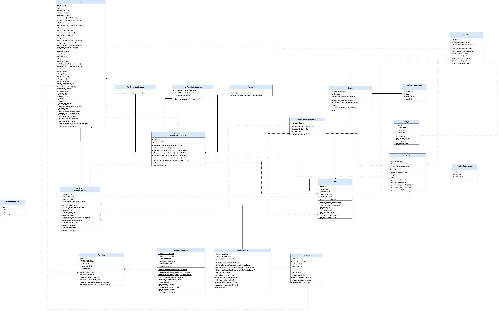

# 🚢 SIGA Porto

**Sistema Inteligente de Gestão de Atracações de Navios**

Atividade apresentada no componente curricular **Programação Orientada a Objetos**.
Integrantes: Caue Roberto, Gabriel Gonçalves e João Otavio

---

## 📌 Sobre o projeto

O SIGA Porto é uma aplicação desktop em Python (Tkinter) para apoiar o operador portuário na decisão de **qual navio atracar, em qual berço e quando**. Ele cruza:

- a **fila de navios** (calado, tamanho, tipo e volume de carga);
- os **berços** disponíveis (capacidade, tipos de carga aceitos, status);
- os **eventos de risco** em tempo real: **clima** (vento e chuva) e **maré** (altura do nível do mar), obtidos da API [Open-Meteo](https://open-meteo.com/);
- a **política de atracação** escolhida pelo operador.

Cada operação de atracação e liberação fica registrada em um histórico persistente.

## ✨ Funcionalidades

- **Login por operador e porto**: cada usuário está vinculado a um porto e só acessa os dados dele.
- **Suporte a 4 portos**: Santos, Rio de Janeiro, Paranaguá e Suape, cada um com seu próprio arquivo de dados.
- **Painel geral** com navios na fila, berços livres, alertas ativos e a **próxima atracação sugerida**.
- **Três políticas de atracação**, trocáveis em tempo de execução:
  - *Por ordem de chegada*: mantém a fila como está.
  - *Por prioridade de carga*: petróleo → granel → contêineres.
  - *Por maré*: prioriza navios que cabem com segurança na janela de maré atual.
- **Avaliação de risco**: o status de cada navio aparece como *Normal*, *Atenção* ou *Risco Alto*, com bloqueio automático quando o clima ou a folga sob a quilha não permitem a atracação.
- **CRUD de navios e berços** com validação dos campos.
- **Histórico de operações** (atracações e liberações) com data e hora.
- **Configurações**: limites de vento, chuva e maré mínima, política padrão e notificações.

## 🧱 Conceitos de POO aplicados

| Conceito | Onde aparece |
|---|---|
| **Abstração** | `EventoDeRisco` e `PoliticaDeAtracacao` são classes abstratas (`ABC`) com métodos `@abstractmethod`. |
| **Herança** | `CondicaoClimatica` e `JanelaDeMare` herdam de `EventoDeRisco`; `PorOrdemDeChegada`, `PorPrioridadeDeCarga` e `PorMare` herdam de `PoliticaDeAtracacao`; `App` herda de `tk.Tk`. |
| **Polimorfismo** | `bloqueia_atracacao()` e `descricao()` têm comportamentos diferentes para clima e maré; `chave_de_ordenacao()` muda conforme a política. |
| **Encapsulamento** | Atributos privados/protegidos (`__tipo`, `_status`, `_navio_atual`) acessados por getters e setters com validação. |
| **Composição** | `Navio` contém uma `Carga`; `Historico` contém vários `RegistroOperacional`; `App` contém `Historico` e `GerenciadorDeAtracacao`. |
| **Agregação** | `Berco` referencia o `Navio` atracado; `App` mantém a fila de navios, os berços e os eventos. |
| **Enumerações** | `StatusOperacional` (LIVRE, OCUPADO, MANUTENCAO) e `NivelDeImpacto` (BAIXO a CRITICO). |
| **Padrão Strategy** | As políticas de atracação são estratégias intercambiáveis usadas pela mesma interface. |

## 🗺️ Diagrama de classes



### Principais classes

| Classe | Responsabilidade |
|---|---|
| `App` | Interface gráfica (Tkinter): login, telas, navegação e configurações. |
| `GerenciadorDeAtracacao` | Executa atracações, liberações e o avanço de turno, e calcula o status de risco de cada navio. |
| `Navio` / `Carga` | Dados do navio (calado, tamanho, capacidade) e da carga transportada. |
| `Berco` | Recebe navios compatíveis em tipo de carga e tamanho; controla o status operacional. |
| `PoliticaDeAtracacao` | Ordena a fila e encontra a próxima atracação possível. |
| `EventoDeRisco` | Base dos eventos que podem bloquear uma atracação. |
| `CondicaoClimatica` | Classifica vento e chuva em níveis de impacto. |
| `JanelaDeMare` | Calcula a profundidade disponível e a folga sob a quilha. |
| `ApiClima` / `ApiMare` | Consultam a Open-Meteo com cache e novas tentativas automáticas. |
| `Historico` / `RegistroOperacional` | Registram e persistem as operações em JSON. |
| `Repositorio` | Carrega e salva navios e berços de cada porto em JSON. |

## 📁 Estrutura do projeto

```
.
├── main.py                  # Interface gráfica (App) e ponto de entrada
├── configuracoes.json       # Preferências do operador
├── usuarios.json            # Usuários e porto vinculado
├── docs/
│   └── diagrama_classes_siga.jpg
└── model/
    ├── ApiClima.py
    ├── ApiMare.py
    ├── Berco.py
    ├── Carga.py
    ├── CondicaoClimatica.py
    ├── EventoDeRisco.py
    ├── Gerenciador.py
    ├── Historico.py
    ├── JanelaDeMare.py
    ├── Navio.py
    ├── PoliticaDeAtracacao.py
    ├── Repositorio.py
    ├── StatusOperacional.py
    ├── historico.json
    ├── info.json            # Porto de Santos
    ├── info_rio.json        # Porto do Rio de Janeiro
    ├── info_paranagua.json  # Porto de Paranaguá
    └── info_suape.json      # Porto de Suape
```

## ⚙️ Requisitos

- Python **3.10+**
- Tkinter (já vem com a maioria das instalações do Python)
- Bibliotecas externas:

```bash
pip install requests-cache retry-requests
```

## ▶️ Como executar

```bash
python main.py
```

1. Na tela de login, informe **operador**, **senha** e o **porto** vinculado ao usuário (veja `usuarios.json`).
2. No **Painel geral**, confira a próxima atracação sugerida e clique em **Atracar**.
3. Use **Avançar turno** para liberar os berços ocupados.
4. Em **Política de Atracação**, compare a prévia da fila de cada política antes de confirmar.

> Os dados de clima e maré dependem de conexão com a internet. Sem conexão, o sistema continua funcionando, mas sem os eventos de risco.

## 👥 Autores

- Nome do integrante 1
- Nome do integrante 2

---

Projeto acadêmico desenvolvido para o componente **Programação Orientada a Objetos**.
